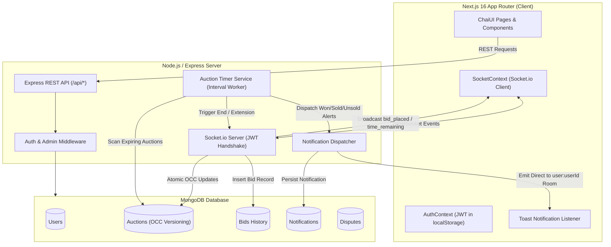

# BidNow — Real-Time Auction System

> A production-grade real-time online auction platform engineered for sub-second bidding precision, atomic concurrency control, synchronized server timers, automated anti-sniping defense, and full administrative moderation.

---

## ⚡ Architecture & Real-Time Flow



---

## 🛠️ Tech Stack

### Frontend
- **Framework**: Next.js 16 (App Router, React 19)
- **Language**: TypeScript
- **Styling**: Tailwind CSS v4, PostCSS
- **Design System**: ChaiUI Look (Warm near-black palette, Manrope headlines, Montserrat accents, asymmetric corners, hairline borders)
- **Real-Time Client**: Socket.io-client v4
- **Icons**: Lucide React

### Backend
- **Runtime**: Node.js (Native ES Modules `"type": "module"`)
- **Web Framework**: Express v4
- **WebSocket Engine**: Socket.io v4 with JWT handshake authentication
- **Database ORM**: Mongoose v8
- **Authentication**: Stateless JSON Web Tokens (JWT) + bcryptjs
- **File Uploads**: Multer with localized static asset serving

### Database
- **Engine**: MongoDB (MongoDB Atlas or self-hosted MongoDB 6+)
- **Concurrency**: Optimistic Concurrency Control (OCC) using document versioning

---

## ✨ Key System Features

### 1. Sub-Second Real-Time Bidding
- WebSocket room isolation per auction (`auction:<auctionId>`).
- Live bid updates broadcast instantly to all connected viewers without polling or browser refreshes.

### 2. Atomic Optimistic Concurrency Control (OCC)
- Strict document versioning (`version` and `currentBid`) ensures that concurrent simultaneous bids are validated atomically in MongoDB.
- Guarantees zero race conditions or phantom bids under high concurrency. Conflicting bids receive an immediate `bid_rejected` notification.

### 3. Anti-Sniping Protection
- If a valid bid is placed within the final **30 seconds** of an auction, the server automatically extends the auction deadline by **60 seconds**.
- An updated `time_remaining` payload is immediately broadcast to the room, eliminating malicious last-second bot sniping.

### 4. Background Server Timer Engine
- Independent server timer service scans active auctions every second.
- Automatically handles auction conclusion: marks auctions as `completed` (with highest bidder) or `unsold` (zero bids).
- Broadcasts `auction_ended` socket events and dispatches persistence notifications.

### 5. Multi-Channel Notification System
- Real-time pop-up toasts for critical events (`outbid`, `auction_won`, `auction_sold`, `auction_ending_soon`, and `system_announcement`).
- Dedicated user notifications inbox with unread tracking, filtering, and mark-as-read actions.
- Targeted WebSocket delivery directly to authenticated user rooms (`user:<userId>`).

### 6. Full Administrative Dashboard
- **Live Analytics**: Aggregated 30-day bid volumes, active user counts, auction status distributions, and dispute stats via MongoDB aggregation pipelines.
- **User Moderation**: Real-time user account search, suspension (with immediate remote socket disconnection), and reactivation.
- **Auction Moderation**: Review catalog listings, flag suspicious items, force-terminate live auctions with real-time room closure, and remove listings.
- **Dispute Resolution Center**: Case investigation interface with status tracking (`open`, `resolved`, `dismissed`) and automated party notification upon resolution.
- **Global Announcements**: Broadcast platform-wide alerts to all online users with persistent notification storage.

---

## 📁 Project Structure

```
real_time_auction_system/
├── client/                               # Next.js 16 Frontend
│   ├── src/
│   │   ├── app/                          # App Router pages
│   │   │   ├── admin/                    # Admin Dashboard routes
│   │   │   │   ├── auctions/page.tsx     # Auction moderation
│   │   │   │   ├── disputes/page.tsx     # Dispute resolution
│   │   │   │   ├── users/page.tsx        # User account management
│   │   │   │   ├── layout.tsx            # Admin route guard & tabs
│   │   │   │   └── page.tsx              # Analytics overview & broadcast
│   │   │   ├── auctions/                 # Public auction catalog & live detail
│   │   │   │   ├── [id]/page.tsx         # Live bidding arena
│   │   │   │   └── page.tsx              # Filterable auction catalog
│   │   │   ├── dashboard/                # User dashboard & profile
│   │   │   │   ├── create/page.tsx       # Create listing with image upload
│   │   │   │   ├── edit/[id]/page.tsx    # Edit pending listing
│   │   │   │   ├── notifications/        # User notifications inbox
│   │   │   │   ├── profile/page.tsx      # Profile settings
│   │   │   │   └── page.tsx              # My auctions & bids
│   │   │   ├── login/page.tsx            # Login page
│   │   │   ├── register/page.tsx         # Registration page
│   │   │   ├── layout.tsx                # Root layout with Toast & Navbar
│   │   │   └── page.tsx                  # Homepage / Landing page
│   │   ├── components/                   # Reusable components
│   │   │   ├── ui/                       # ChaiUI atomic components (button, card, input)
│   │   │   ├── Navbar.tsx                # Responsive top navigation
│   │   │   └── Toast.tsx                 # Socket toast notification system
│   │   ├── context/                      # React Context providers
│   │   │   ├── AuthContext.tsx           # Authentication state & session
│   │   │   └── SocketContext.tsx         # Socket.io connection provider
│   │   ├── lib/                          # Client utilities & API client
│   │   └── types/                        # TypeScript interfaces
│   ├── postcss.config.mjs
│   ├── tailwind.config.ts
│   └── package.json
│
├── server/                               # Node.js Express & Socket.io Backend
│   ├── src/
│   │   ├── config/                       # DB and environment configuration
│   │   ├── controllers/                  # Route business logic
│   │   │   ├── admin.controller.js       # Admin operations & aggregations
│   │   │   ├── auction.controller.js     # Auction CRUD & queries
│   │   │   ├── auth.controller.js        # Authentication & JWT issuance
│   │   │   ├── notification.controller.js# User notifications
│   │   │   └── user.controller.js        # User profile
│   │   ├── middleware/                   # Express middlewares
│   │   │   ├── admin.middleware.js       # Admin role authorization
│   │   │   ├── auth.middleware.js        # JWT authentication & suspend check
│   │   │   └── upload.middleware.js      # Multer image upload handling
│   │   ├── models/                       # Mongoose schemas
│   │   │   ├── Auction.js                # Auction listing schema with versioning
│   │   │   ├── Bid.js                    # Bid log schema
│   │   │   ├── Dispute.js                # Dispute resolution schema
│   │   │   ├── Notification.js           # Notification schema
│   │   │   └── User.js                   # User account schema
│   │   ├── routes/                       # Express route definitions
│   │   ├── services/                     # Background services
│   │   │   ├── auctionTimer.service.js   # Background auction expiration worker
│   │   │   └── notification.service.js   # Multi-channel notification dispatch
│   │   ├── socket/                       # Socket.io handlers
│   │   │   ├── bidding.handler.js        # Atomic OCC bidding & anti-sniping
│   │   │   └── index.js                  # Socket handshake & room routing
│   │   ├── utils/                        # Token & helper utilities
│   │   └── app.js                        # Express server entry point
│   ├── uploads/                          # Static uploaded image directory
│   └── package.json
│
├── openspec/                             # OpenSpec change definitions & tasks
└── README.md                             # Project documentation
```

---

## 🚀 Getting Started

### Prerequisites
- **Node.js**: v18.17.0 or later (v20+ recommended)
- **npm** or **pnpm**
- **MongoDB**: Local MongoDB instance or free MongoDB Atlas URI

---

### Step 1: Clone & Configure Server

1. Navigate to the `server/` directory:
   ```bash
   cd server
   ```

2. Install backend dependencies:
   ```bash
   npm install
   ```

3. Create your `server/.env` configuration:
   ```env
   PORT=5000
   MONGODB_URI=mongodb://localhost:27017/auction_system
   JWT_SECRET=your_super_secret_jwt_key_here
   JWT_EXPIRY=1h
   CLIENT_URL=http://localhost:3000
   ```

4. Start the backend development server:
   ```bash
   npm run dev
   ```
   *The server starts on `http://localhost:5000` with WebSocket support enabled.*

---

### Step 2: Configure & Launch Client

1. Open a new terminal and navigate to the `client/` directory:
   ```bash
   cd client
   ```

2. Install frontend dependencies:
   ```bash
   npm install
   ```

3. Create your `client/.env.local` configuration:
   ```env
   NEXT_PUBLIC_API_URL=http://localhost:5000/api
   NEXT_PUBLIC_SOCKET_URL=http://localhost:5000
   ```

4. Launch the Next.js development server:
   ```bash
   npm run dev
   ```
   *The client will be running on `http://localhost:3000`.*

---

### Step 3: Production Build

To build and run the optimized production bundle:

```bash
# Build & start server
cd server
npm start

# Build & start client
cd ../client
npm run build
npm start
```

---

## 📡 API & Socket.io Reference

### Core REST Endpoints

| Method | Endpoint | Description | Access |
|---|---|---|---|
| `POST` | `/api/auth/register` | Register new user account | Public |
| `POST` | `/api/auth/login` | Authenticate and obtain JWT | Public |
| `GET` | `/api/auth/me` | Fetch active user session | Authenticated |
| `GET` | `/api/auctions` | Filter, search and paginate auctions | Public |
| `POST` | `/api/auctions` | Create listing with image uploads | Authenticated |
| `GET` | `/api/auctions/:id` | Get single auction details | Public |
| `PATCH` | `/api/auctions/:id` | Update pending listing | Seller |
| `DELETE` | `/api/auctions/:id` | Cancel pending listing | Seller |
| `GET` | `/api/notifications` | Paginated notification history | Authenticated |
| `PATCH` | `/api/notifications/:id/read` | Mark notification as read | Authenticated |
| `PATCH` | `/api/notifications/read-all` | Mark all notifications read | Authenticated |
| `GET` | `/api/admin/analytics` | Aggregated platform metrics | Admin |
| `GET` | `/api/admin/users` | Search & filter user accounts | Admin |
| `PATCH` | `/api/admin/users/:id/suspend` | Suspend user & cut sockets | Admin |
| `PATCH` | `/api/admin/users/:id/reactivate` | Reactivate suspended user | Admin |
| `POST` | `/api/admin/auctions/:id/terminate` | Force-close live auction | Admin |
| `PATCH` | `/api/admin/auctions/:id/flag` | Flag auction for review | Admin |
| `GET` | `/api/admin/disputes` | List open/resolved disputes | Admin |
| `PATCH` | `/api/admin/disputes/:id/resolve` | Resolve dispute with note | Admin |
| `POST` | `/api/admin/announcements` | Broadcast system announcement | Admin |

### Socket.io Events

| Event | Direction | Payload | Description |
|---|---|---|---|
| `join_auction` | Client ➔ Server | `{ auctionId }` | Joins the room for that auction |
| `leave_auction` | Client ➔ Server | `{ auctionId }` | Leaves the auction room |
| `place_bid` | Client ➔ Server | `{ auctionId, amount }` | Submits atomic OCC bid |
| `auction_state` | Server ➔ Client | `{ currentBid, bidCount, ... }` | Returns initial auction state |
| `bid_placed` | Server ➔ Room | `{ auctionId, currentBid, bidder }` | Broadcasts successful bid |
| `bid_rejected` | Server ➔ Client | `{ reason }` | Emitted when OCC or validation fails |
| `time_remaining` | Server ➔ Room | `{ auctionId, secondsLeft }` | Clock tick & anti-snipe updates |
| `outbid` | Server ➔ User | `{ auctionId, newBidAmount }` | Targeted alert to previous highest bidder |
| `auction_ended` | Server ➔ Room | `{ auctionId, status, winnerId }` | Broadcasts auction conclusion |
| `system_announcement` | Server ➔ All | `{ title, message }` | Platform-wide announcement alert |

---

## 🔒 Security & Data Integrity Highlights
- **Stateless JWT Authentication**: Handshake-level authentication protects WebSocket channels and user-specific rooms.
- **Account Suspension Enforcement**: Suspended users are instantly disconnected from WebSocket sessions and rejected by API middlewares.
- **Self-Bidding Prevention**: Sellers are strictly prohibited from bidding on their own listings.
- **Atomic Optimistic Concurrency Control**: Rejects simultaneous stale bids via Mongoose document versions.
- **XSS & Injection Protection**: Structured database schemas and sanitized input parameters.

---

## 📄 License
This project is licensed under the MIT License.

